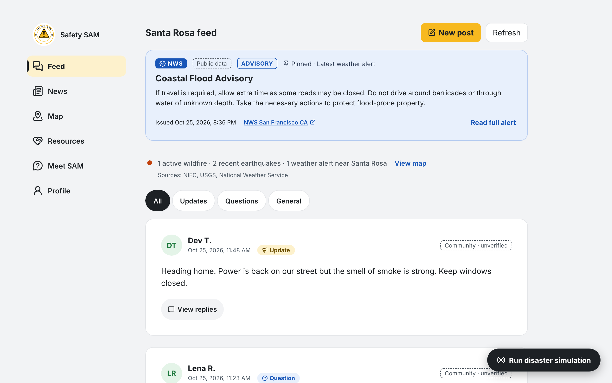
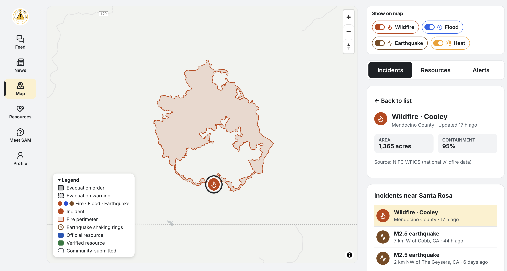
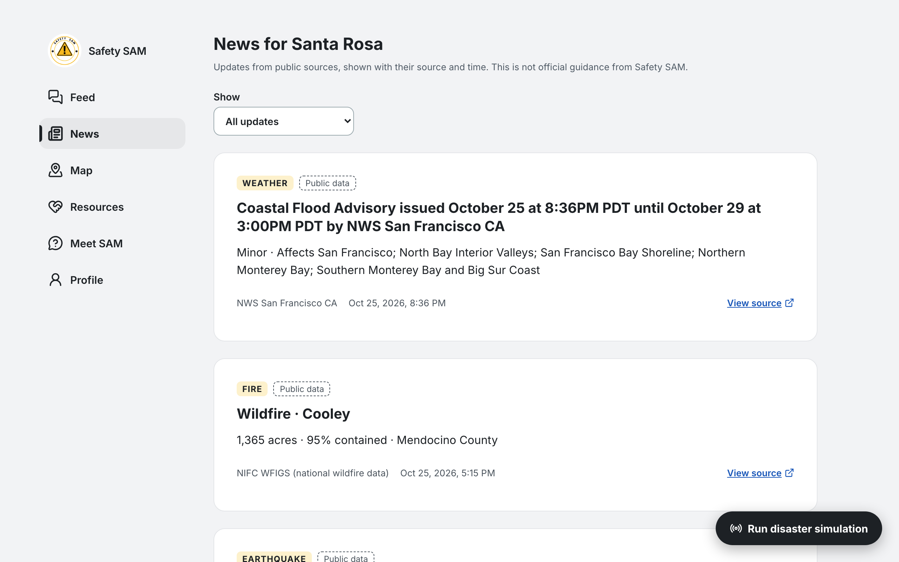

# Safety SAM

Localized disaster preparedness and community communication prototype. Safety SAM is built for any disaster that can affect a local community (wildfire, flood, earthquake, hurricane, severe storm, extreme heat, winter weather), with wildfire as the default demonstration scenario.

## What it is

When a disaster is near, residents have to piece together official alerts, hazard maps, nearby shelters, and what neighbors are saying, across many sites. Safety SAM puts these in one place for a selected city (Santa Rosa, CA in the demo):

- **Community feed**: a calm, city-scoped feed of posts and replies, with the latest alert pinned above it.
- **Live public data**: weather alerts from the National Weather Service, wildfires from NIFC, earthquakes from USGS, and evacuation zones from Cal OES, each shown with its source and fetch time.
- **Map**: incidents, evacuation zones, fire perimeters, shaking rings, weather alerts, and resources on one map.
- **Resources**: shelters, water and food, medical, charging, pets, and transportation, labeled official, verified, or community-submitted.
- **Meet SAM**: an AI assistant that gives short answers from the city's data and points to 911 and official instructions.
- **Languages**: English, Spanish, Vietnamese, and Simplified Chinese.

This is a prototype, not an official emergency service. It does not replace 911, evacuation orders, or responder instructions.

## Screenshots

## How to run

    npm install
    cp .env.example .env.local
    npm run dev

Set `VITE_SUPABASE_URL`, `VITE_SUPABASE_ANON_KEY`, and `VITE_MAP_STYLE_URL` in `.env.local`. Without the Supabase values the live feed stays off and the rest of the app still works.

Other commands: `npm run build`, `npm run lint`, `npm test`.
